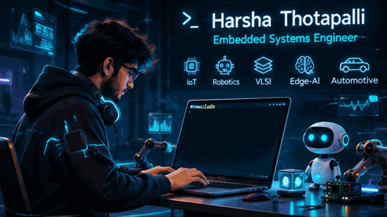

# Hi, I'm Harsha 👋

  

  <b>EMBEDDED SYSTEMS ENGINEER | FIRMWARE DEVELOPER | ROBOTICS ENTHUSIAST</b>

  Building intelligent hardware, developing embedded firmware and bringing autonomous systems to life.

---

## ⚡ About Me

I'm an aspiring **Embedded Systems Engineer** passionate about connecting hardware and software to build intelligent real-world solutions.

- 🔧 Embedded Firmware & Microcontroller Development
- 🤖 Robotics and Autonomous Systems
- ⚙️ Real-Time Embedded Applications
- 🧠 Edge AI & Computer Vision
- 🚀 Hardware Prototyping and System Integration

---

## 🚀 Featured Engineering Projects

<table>
<tr>
<td width="50%" valign="top">

### 🤖 ESP32 Swarm Robotics

A collaborative robotics platform featuring autonomous navigation, LiDAR-based obstacle avoidance and robot communication.

**Technologies**

`ESP32` `C++` `LiDAR` `Robotics`

<a href="https://github.com/harshathotapalli08-wq/esp32-swarm-robotics">VIEW PROJECT →</a>

</td>
<td width="50%" valign="top">

### 🚘 AI Dashcam

An intelligent edge-AI dashcam designed for driver monitoring, accident detection, distraction detection and lane departure detection.

**Technologies**

`Raspberry Pi 5` `Python` `YOLO` `OpenCV`

<a href="https://github.com/harshathotapalli08-wq/ai-dashcam">VIEW PROJECT →</a>

</td>
</tr>
<tr>
<td width="50%" valign="top">

### 🔥 Autonomous Fire Detection Robot

An autonomous robot combining fire detection, obstacle avoidance, GPS tracking, GSM alerts and an automated water pump.

**Technologies**

`ESP32` `Sensors` `SIM900A` `NEO-6M`

<a href="https://github.com/harshathotapalli08-wq/fire-detection-obstacle-avoidance-robot">VIEW PROJECT →</a>

</td>
<td width="50%" valign="top">

### 🚨 Accident Detection & Alert System

An embedded safety system that detects vehicle accidents and sends emergency alerts with GPS location information.

**Technologies**

`Arduino` `Embedded C` `GPS` `GSM`

<a href="https://github.com/harshathotapalli08-wq/accident-detection-alert-system">VIEW PROJECT →</a>

</td>
</tr>
</table>

---

## 🧰 Technical Arsenal

<b>MICROCONTROLLERS & HARDWARE</b>

<b>PROGRAMMING & FIRMWARE</b>

<b>ROBOTICS & INTELLIGENT SYSTEMS</b>

<b>DEVELOPMENT TOOLS</b>

---

## 📊 GitHub Activity

  
  

---

## 🌌 Engineering Mindset

  <b>BUILD. EXPERIMENT. INNOVATE.</b>
    
  <i>Turning ideas into intelligent machines, one circuit at a time.</i>
    
  
  

  HARSHА THOTAPALLI | EMBEDDED SYSTEMS & ROBOTICS

